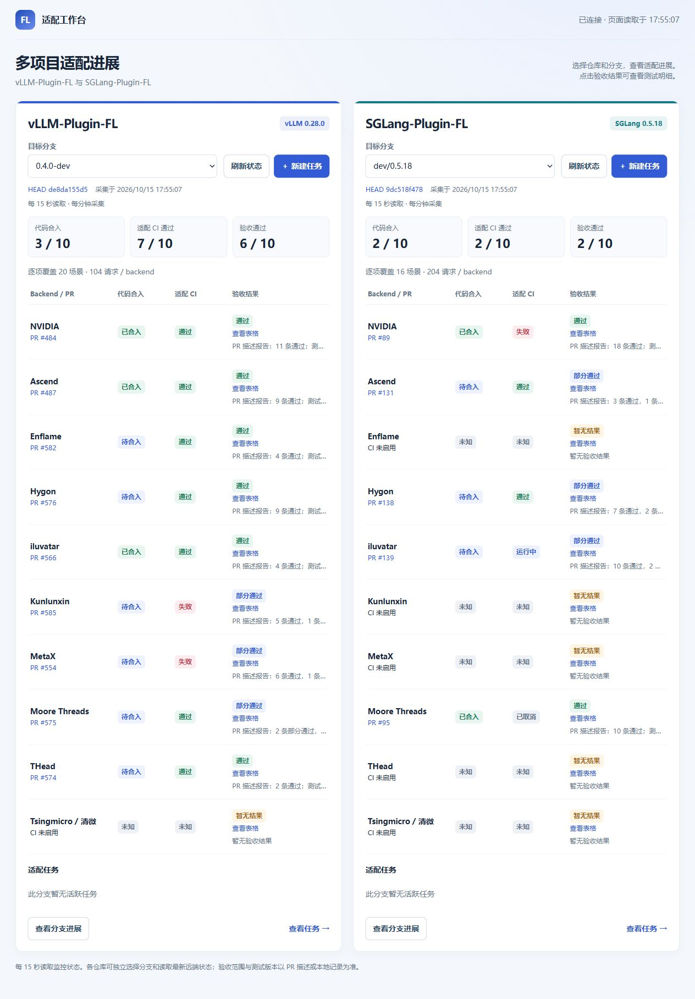

# FL 插件适配工作台

在 **DeepSeek Harness** 左侧边栏里跟踪 **vLLM-Plugin-FL** 和 **SGLang-Plugin-FL** 的适配
进展：各 backend 的 PR、CI、验收结果、GPU 设备和 agent 任务，都在一个原生面板里，跟随
主题和语言，不用 iframe。



*适配进展总览（2026-10-15）。在线状态以最新采集结果为准。*

面板读的是本机一个 Python 看板进程。那个看板也可以单独用浏览器打开，还带局域网只读访问
和分享链接 —— 见[独立使用](docs/STANDALONE.md)。两种用法共用同一份配置和采集数据。

- 双仓库独立选择分支，结合 PR 标题与描述关联适配 PR；合入后继续跟踪，并核验合并提交属于所选分支。
- 从已采集设备中选择机器和 Codex、Claude 或 FlagScale Agent 创建任务；backend 按采集结果自动匹配，远端目录自动分配。
- 任务可继续同一会话，看板保留进展；长日志中的活跃任务持续显示。
- 验收结果优先读取 PR 描述，点击查看测试表格；保留本地存档与原生子会话进展。
- 集成 [jms-top](https://github.com/lvyufeng/jms-top) 的多厂商资源采集：查看空闲卡、显存、负载及进程。
- 登录 JumpServer 后刷新授权机器列表；也可沿用 SSH 配置，支持 Include。设备信息保存在本地。

## 安装

准备 **Python 3.11+ 和 Git**（看板只用 Python 标准库，不需要 pip 装依赖，也不需要 GPU
环境）。从 [Releases](../../releases) 下载 `local-fl-upgrade-workflow-<版本>.tgz`。

**在界面里装**（推荐，不用开终端）：左侧边栏点**插件** → **添加插件**，在「包名或地址」
里填刚下载的那个 `.tgz` 的**绝对路径**，然后点**安装**：

```text
C:\Users\<你>\Downloads\local-fl-upgrade-workflow-0.2.0.tgz
```

这个输入框是文本框，不是文件选择器，所以路径要自己粘进去（在文件管理器里复制文件路径
即可）。Linux / macOS 同理，填 `/home/<你>/Downloads/...`。

**必须是绝对路径。** `./xxx.tgz` 会被直接拒绝；只填文件名 `xxx.tgz` 更麻烦 —— 它会被
当成 npm 包名去注册表上找，然后报「未找到相关插件」，看起来像是包坏了，其实只是路径
没写全。

**或者用命令行**：

```sh
dsh plugin install /绝对路径/local-fl-upgrade-workflow-0.2.0.tgz
```

也可以自己打包，产物与发布的一致（纯标准库，不需要 Node）：

```sh
python -B scripts/pack_dsh_plugin.py --output-dir dist
```

打包是可复现的：条目排序固定、时间戳固定、换行统一为 LF，所以同一份源码在任何平台打出的
包字节一致，发布的 sha256 才有意义。

插件源码在 [integrations/dsh-plugin/](integrations/dsh-plugin/)，那里的
[README](integrations/dsh-plugin/README.md) 写了完整的安全边界和已知限制。

## 配置

安装后必须填 `repoPath`，面板在这之前什么也做不了：

| 配置项 | 说明 |
| --- | --- |
| `repoPath` | **必填**，本项目检出的绝对路径 |
| `port` | 看板监听的回环端口，默认 `8766` |
| `pythonPath` | 留空则用 PATH 上的 `python`，需要 3.11+ |
| `projectsConfig` | 留空则依次找 `runs/configured/projects.json`、`projects.json` |
| `autoStart` | 插件激活时是否自动拉起看板进程，默认 `false` |

还没有配置过看板也没关系：面板里「在本机部署」是高亮的入口，勾选项目、填检出路径和
目标分支，它会调用本项目自带的 `configure.py` 和启动器完成配置并启动，不重新实现一套
配置逻辑。看板已经在跑（包括你自己在终端里起的）时，插件会识别并接管显示，不会重复启动。

要监控的插件仓库需要先 clone 到本地：
[vLLM-Plugin-FL](https://github.com/flagos-ai/vllm-plugin-FL)、
[SGLang-Plugin-FL](https://github.com/flagos-ai/sglang-plugin-FL)。checkout 需包含所选
remote 的目标分支，缺少时先 `git fetch <remote>`。建议安装并登录 `gh` 读取 GitHub 状态；
执行适配任务时再准备 agent CLI、SSH 和远端 GPU 环境。

## 面板能做什么

- 项目和分支切换，后端视图（合入、CI、验收、门禁）和任务视图
- 设备视图：GPU 机群状态，可按硬件厂商筛选。它不在分支标签页里面，因为机群是所有项目
  共用的，和你选哪个分支无关
- 任务详情：计划、最新消息、进展摘要和对话记录，可发送后续消息
- 新建任务：**只准备不启动**。上游带 `start` 的那次请求会同时创建并启动，也就是立刻
  开始烧模型额度、在远端机器上执行命令，所以启动留在看板里做。准备本身也会建 worktree
  并占用机器，这件事写在按钮上方
- 项目仓库：按看板配置自动识别检出目录，一键加入 Harness 工作区，并在该工作区里新建
  一个带好上下文的对话。只登记已存在的目录，不执行 `git clone` —— 仓库不在本地时只给
  一条可复制的命令
- 凭据：显示 Claude / JumpServer / GitHub / SSH 各自是否就绪。只有前两个能在面板里填，
  因为只有它们在看板侧有加密落盘的位置；GitHub token 看板只从环境变量读，SSH 私钥只按
  路径引用从不读取内容，给它们做表单等于让插件为密钥自己发明存储

工作区按项目命名，不带分支；分支名放在里面的对话上。目录里的分支随时会被 `git checkout`
改掉，写在工作区名字上就会过期，而一次对话本来就只讲一个分支。

任务列表默认只显示从插件创建的任务。上游不记录任务由谁创建（没有这类字段，未知字段还
会被静默丢弃），所以插件把创建时返回的 id 记在 `runs/` 下（已被 git 忽略，只存 id），
想看全部可以一键切换。

## 安全边界（摘要）

- 浏览器不直连看板，所有读取走插件在 Harness 上的代理，**只放行一份只读白名单**。
  `/api/codex-sessions`、`/api/jumpserver`、`/api/agent-settings` 这些带机器身份和凭据
  位置的接口全部拒绝
- 出站前裁剪字段，并对 agent 写的自由文本额外脱敏（绝对路径、主机、账号、IP）
- 机器列表只保留 id、脱敏标签、后端、角色和「有没有远端工作目录」这个布尔值
- 凭据只走 POST 请求体。原因很具体：看板的控制服务器会把每个请求行写进明文日志，
  密钥出现在 query string 就等于落盘。插件自己不保存、不回显、不写浏览器存储
- 浏览器拿不到文件系统路径，目录只以名字出现
- 创建任务和填凭据只能由人在面板里操作，不进 agent 工具

看板自己**没有任何身份认证**，只靠绑定回环地址和 Host / Origin 检查。完整清单见
[插件 README](integrations/dsh-plugin/README.md#安全边界)。

## 更多文档

- [独立使用](docs/STANDALONE.md)：不装 Harness，直接用浏览器页面，含页面入口和局域网只读访问。
- [部署指南](docs/DEPLOYMENT.md)：配置向导、无人值守配置、HTTPS、免登录只读和后台常驻。
- [高级配置与验收参考](docs/REFERENCE.md)：agent 配置、原生任务接入、结果归档、命令编排与异常恢复。
- [结构与扩展指南](docs/ARCHITECTURE.md)：代码结构、新增同类项目、接入新监控类型。

## 代码结构与扩展

业务代码位于 `fl_dashboard/`，按 monitoring、projects、agents、tasks、services、deployment
分工；页面在 `web/templates/`，示例配置在 `examples/`。根目录仅保留 `dashboard.py` 统一
入口，命令脚本集中在 `scripts/`，Harness 插件在 `integrations/dsh-plugin/`。新增同类仓库
只需增加项目配置；新监控类型通过可信采集器注册接入，默认只读。详见
[结构与扩展指南](docs/ARCHITECTURE.md)。
