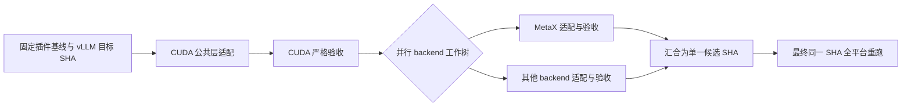

# vllm-plugin-FL 升级工作流：可配置首版

这个目录提供分支适配监控、Codex 升级任务页面和本地编排器。监控面板分别显示 backend 的代码合入、CI 和 adaptation gate 状态；任务页面可按验证机器启动独立 Codex 会话并跟进进展。编排器支持先适配 CUDA 公共层，再让其他 backend 并行运行。页面由本地 HTTP 服务提供，可在 Codex 桌面端的内置 Browser 面板打开。

## 分支适配监控

将 `branch-monitor.example.json` 复制为 `branch-monitor.json`，核对插件仓库路径、remote、分支、模型和 backend PR 编号。启动 `python flflow.py serve --config workflow.json --monitor-config branch-monitor.json` 后，首页 `/` 显示分支监控；原工作流控制页在 `/workflow`。页面可切换本地 remote-tracking 分支，并用“读取最新状态”更新目标分支 Git ref 与 GitHub CI。`branch-monitor.json` 是本机配置，已被 Git 忽略。

监控服务优先通过已登录的 `gh api` 读取 GitHub 状态；若未安装或不可用，则用 GitHub HTTP API（可通过 `GH_TOKEN` 或 `GITHUB_TOKEN` 提高配额）。远端数据缓存 5 分钟；页面每 15 秒读取服务状态，点击“读取最新状态”会触发一次采集并直接显示返回结果。网络故障会明确显示错误，页面保留上次采集时间。

可配置 `backend_pr_discovery`，按目标分支、候选分支前缀和标题词查找替代 PR；关闭的旧 PR 不会掩盖唯一的新候选。如果匹配多个 PR，服务报告歧义并保留明确配置的关联，需维护者指定编号。PR 打开、代码已合入、CI 和 Gate 仍分别判定。

监控清单从**所选分支**的 `.github/configs/platforms.yml` 和 `tools/adaptation-gate-cases/test_*.py` 读取。当前 `0.4.0-dev` 的 gate 包含两个 Qwen3.6 模型、eager/graph 两种模式、每组 5 个 pytest 场景（合计 20 个场景、104 个请求）。代码已合入、CI 成功和 Gate 通过是三个独立状态。直接验收结果由运行清单绑定 backend、实际测试提交、模型、模式和端口，再检查每个 JSON 的逐请求结果。历史验收记录会单独标注来源和接受版本，不会伪装成当前 HEAD 的新一轮测试；本机演示结果也不会计入分支监控。

要让 Gate 显示真实结果，在 `evidence_dir` 下为每次 backend / 模型 / 模式运行放一个 `manifest.json`，并把 `tools/adaptation-gate-cases` 写出的 5 个场景 JSON 放在清单指定的 `results_dir`。例如 `runs/gate-evidence/cuda/Qwen3.6-27B/eager/run-001/manifest.json`：

```json
{
  "schema_version": 1,
  "run_id": "run-001",
  "backend": "cuda",
  "branch": "0.4.0-dev",
  "commit": "e88e4db75ece36e482a5fcc288929d4461d53184",
  "model": "Qwen3.6-27B",
  "mode": "eager",
  "port": 8000,
  "results_dir": "results"
}
```

`results_dir` 相对清单所在目录。只有清单的 commit 等于所选分支 HEAD、五个 JSON 全部对应当前 case 且每个请求的检查均通过，该模型 / 模式下的五个 case 才会显示通过。完整 backend Gate 还需两个模型的两种模式全部通过。当前仓库不自动从 GPU 或 CI 下载这些 JSON。

截至 2026-09-24，`0.4.0-dev` 已合入 [NVIDIA 适配 PR #484](https://github.com/flagos-ai/vllm-plugin-FL/pull/484)。验收版本 `5e95688` 的 [CI run 35199866402（attempt 2）](https://github.com/flagos-ai/vllm-plugin-FL/actions/runs/35199866402) 全部 NVIDIA 测试通过；该版本与合入提交 `e88e4db` 的完整 Git tree 相同。之后合入提交的 [CI run 35660209641](https://github.com/flagos-ai/vllm-plugin-FL/actions/runs/35660209641) 失败，面板单独显示这次分支 CI，保留已通过的适配验收记录。

NVIDIA Gate 的四组 5/5 结果见 [PR #492](https://github.com/flagos-ai/vllm-plugin-FL/pull/492) 和 PR #484。原始 20 份 JSON 已在本机证据目录归档，逐项核验为 **20/20 场景、104/104 请求通过**。这些结果于 2026-09-16 在 A800 TP2 上运行，使用 `d98ebec` 导出源码加后来提交为 `630d96a` 的 `scatter_` 修复。它们是升级 PR 接受的历史验收证据，不是在最终 HEAD 上重新执行的结果；原始执行版本与验收版本分别记录。原始数据和本机配置均不提交到本仓库。

Ascend、MetaX 和 CoreX 等候选 PR 显示在各自 backend 行。候选工作分支通过测试后，应按**实际测试的 commit** 收集 Gate JSON；PR 尚未合入时，该结果不能表示目标分支已通过验收。

## Codex 升级任务

启动服务后打开 `/sessions`。先安装并登录本机 Codex CLI；服务使用官方 [Codex app-server](https://developers.openai.com/codex/app-server/) 协议创建、继续和监控会话。需要时可在 `branch-monitor.json` 设置 `codex_executable` 的完整路径。页面中的“检查连接”会检查 CLI 和登录状态。

任务页支持选择本机 SSH 别名，或填写主机、用户、端口、密钥文件路径及可选的跳板机别名。密钥只引用本机文件；页面不接收密码或私钥内容，连接配置保存在被 Git 忽略的运行目录。首次连接须在本机终端核对主机指纹，并配置可用于非交互登录的密钥或 ssh-agent。

填写 backend、目标分支、已存在的远端项目目录、模型路径映射和本次目标后，点击“保存连接并检查”。预检读取 SSH、Git 仓库、tmux 与已配置模型路径；失败会显示具体检查结果并阻止启动。选择“仅创建，稍后启动”会固定起始提交并创建独立 Git worktree；点击“检查连接并启动适配 agent”会再次检查并下发任务。同一 SSH 别名或同一直接连接的主机、用户、端口只允许一个待启动或活动任务；不同机器可并行跟进不同 backend。

启动后默认进入首页监控。适配任务每 3 秒读取一次，显示 agent 报告的实际计划、最新消息、异常和待处理授权/提问；可以在监控页答复、发送补充指令、中断或继续任务，并打开详情查看事件日志。agent 指令要求跟进环境检查、适配、服务启动、原仓库 `tools/adaptation-gate-cases` 验收与证据归档。浏览器关闭不会取消后台执行；服务进程仍需保持运行。

机器列表分别显示最近一次 SSH 连通检查和完整环境预检，附检查时间及失败原因。Windows 向远端发送预检脚本时使用 UTF-8 字节保留 LF；SSH 已通过但远端检查脚本失败时，页面单独报告环境检查失败。修改连接参数会使原连接检查失效；只修改备注不会丢失检查记录。

实际计划来自 Codex 的计划通知；会话没有计划工具时，agent 在自己的隔离工作目录维护 `.flflow-progress.json`。服务只接受身份与 backend 一致的有界进度文件，页面标注来源和更新时间。进度摘要、阶段完成以及“本轮结束”都不会改变 CI 或 Gate 结果。`backend_labels` 中明确配置的 backend 即使尚无 CI、PR 或证据，也会留在状态表中。

任务页显示实时事件和输出，可发送补充指令、回答提问，并逐次确认命令、文件或权限请求。事件日志和 Codex thread ID 保存在本机 `sessions_dir`（默认 `runs/codex-sessions`），服务重启后可从页面继续已有会话。页面通过自己的 app-server 连接管理任务，不保证自动出现在 Codex 桌面侧栏或与侧栏状态同步。

机器清单按 backend 分组，保存硬件说明、识别依据和备注。导入配置时可以暂缺 backend 或远端目录；创建任务前必须补齐。跳板机仅作为连接入口展示。根据别名推断的硬件应标记待核实；机器配置保存在被 Git 忽略的本机运行目录。

“中断当前执行”中断 Codex 当前轮次；远端 tmux 安装、服务或测试仍可能运行。页面对活跃 Codex 任务的机器占用检查不能证明远端作业已经停止，复用机器前须检查实际 tmux 和 GPU 状态。任务会先检查环境，再进行适配和验收；一轮对话结束不等于升级完成或 Gate 通过。收集结果时应保留实际测试提交、模型、模式、命令、时间和原始 JSON，并按上面的证据格式导入分支面板。

`/workflow` 保留基于配置命令的编排器。运行前需将 `workflow.example.json` 中的仓库路径、commit、命令和模型清单替换为真实配置；它只运行明确配置的命令。

### 任务归属与执行位置

对于已有适配 PR 的 backend，在本地监控配置的 `backend_task_policies` 中设置 `mode: "monitor"`，并可填写 `pr` 和 `reason`。策略的 `branch` 省略时使用配置中的默认分支；仅对该基线分支生效。未配置的 backend 保持 `adapt` 模式。

仅监控模式允许查看进展、PR、CI 和 Gate，以及中断旧会话或拒绝待审批操作；服务端会拒绝创建、启动、继续和补充适配指令。相同基线分支与 backend 的任务应继续已有 session，不能通过更换机器或结束一轮对话重复派发。

页面分别显示基线分支和提交、独立工作分支、本地 worktree，以及机器配置中的源目录。实际候选提交和远端任务目录尚未结构化上报时显示待核对，不能将基线提交当作测试候选。每个 backend 的环境、远端 tmux 和原始验收证据都应保留在自己的任务目录。

进度文件可增加可选 `provenance` 对象，记录实际观察到的候选和远端任务目录。填写示例中的占位值，并沿用文件顶层的真实 `session_id`、`backend`、`schema_version: 1`：

```json
{
  "provenance": {
    "branch": "<本 session 的基线分支>",
    "candidate_commit": "<实际候选的完整 40 位十六进制 SHA>",
    "remote_task_workspace": "/work/backend-task",
    "observed_at": "<原始观察时间，RFC3339 格式且带时区>",
    "evidence_paths": [{"path": "evidence/identity.json"}]
  }
}
```

服务端要求分支与 session 一致，远端任务目录为长度不超过 2000 的 Linux 绝对路径，不含控制字符或 `..`，且不能以 `//` 开头。每份记录最多引用 20 个证据文件；`path` 最多 512 字符，使用 worktree 内已有文件的相对路径和 `/` 分隔符，不含空、`.` 或 `..` 组件，禁止越界及指向目录外的链接，每项可附完整 64 位十六进制 `sha256`。引用及哈希只作为 agent 上报记录，服务不会执行远端检查、读取文件内容来核对哈希或据此判定 Gate。

API 将有效记录放在 `session.reported_provenance`，保留上述字段并添加 `source: "agent_report"`。`observed_at` 必须是有效日期的 RFC3339 时间：大写 `T` 分隔日期和时间，显式使用 `Z` 或 `±HH:MM` 时区，可含 1–9 位小数秒；不接受空格分隔、无时区或闰秒。允许最多 5 分钟的时钟偏差；未来异常时间、非法或较旧记录会被忽略，缺失记录也不会清空已接受的记录。候选身份按观察时间独立更新，不受计划通知的优先级影响；更新摘要或复制文件的时间不会刷新证据时间。服务不从自由文本或旧的候选字段推断 provenance，也不会改变机器配置中的源目录、Codex 轮次状态或验收判定。

审批按钮仅展示当前请求支持的单次决定；请求只支持 `cancel` 时，按钮标注“拒绝并结束本轮”，结束后可在原 thread 继续。页面不提供永久执行策略授权。

## 流程与状态



本版实现 A 至 F。它在不同 backend 改出不同提交时返回 `ready_for_integration`，不会把各工作树单独通过误报为最终通过。G/H 应在合并改动后以集成提交重新启动一轮，或交给仓库现有的 GitHub Actions 多平台 CI。只有本轮全部平台在**同一提交**上通过，状态才是 `passed`。

每个平台都使用独立的 Git worktree。CUDA 基线成功后，其他 backend 从它的提交并行开始。状态保存在 `work_dir/state.json`；命令日志、验收证据、工作树也保存在 `work_dir`。失败的 backend 可在 CUDA 基线、配置和验收工具均未变时重试；重试创建新工作树并保留旧日志。适配若修改测试、CI 配置或其他受保护验收输入，会在快照前被拒绝。暂停只阻止后续阶段开始；运行中的命令继续执行。取消会终止本地子进程。

## 准备配置

需要 Python 3.11+、Git、插件仓库和目标 vLLM 源码 checkout。示例的适配命令使用 `codex exec`，因此实际运行它还需要已登录的 Codex CLI。执行 GPU 测试的环境需要对应的设备、驱动、依赖和模型文件。

1. 复制 `workflow.example.json` 为自己的 `workflow.json`。
2. 填写插件仓库根目录 `repo`、上游 vLLM 仓库根目录 `upstream_repo` 和独立的 `work_dir`。后者不能放在两个仓库内部。
3. 填写插件当前干净 checkout 的完整 `plugin_base_sha`，以及目标 vLLM ref 与它解析出的完整 `target_vllm_commit`。例如：`git -C <repo> rev-parse HEAD` 和 `git -C <upstream_repo> rev-parse "<target-ref>^{commit}"`。
4. 按设备填写每个平台的 `adapt_command`、`test_commands`、`device` 和 E2E case 清单。`cases.metax.example.json` 故意为空，填入实际可运行的 case 前，严格验收会失败。
5. 将远程 backend 的测试命令替换为自己的 SSH/CI 适配器。它必须让目标机器取得**当前工作树提交**、等待远端测试真正结束、将证据 JSON 写回本地 `{evidence_file}`。远端长任务用 tmux，SSH 命令不能只是启动会话就返回成功。取消远端任务也需要适配器处理。

配置中的命令是 argv 数组，不经过本地 shell。可用占位符包括 `{repo}`、`{upstream_repo}`、`{tool_dir}`、`{work_dir}`、`{worktree}`、`{platform}`、`{scope}`、`{attempt}`、`{target_vllm_ref}`、`{target_vllm_commit}`、`{plugin_base_sha}`、`{cuda_baseline_commit}`、`{plugin_commit}`、`{evidence_file}`。同名值也通过 `FLFLOW_*` 环境变量传给命令。`repo`、`upstream_repo`、`work_dir` 的相对路径按配置文件位置解析。

## 启动与控制

```text
python flflow.py validate --config workflow.json
python flflow.py start --config workflow.json --dry-run
python flflow.py serve --config workflow.json --host 127.0.0.1 --port 8765
```

`validate` 检查配置和仓库位置。`--dry-run` 还会检查插件基线及上游目标 SHA，但状态是 `simulated`，不算验收。服务启动后，在 Codex 内置 Browser 打开 `http://127.0.0.1:8765/` 查看分支监控，打开 `/sessions` 跟进 Codex 任务，或在 `/workflow` 用“启动、暂停后续阶段、继续、重试失败项、取消”控制编排器并查看日志。编排器也可使用 CLI：`start`、`status`、`pause`、`resume`、`cancel`、`retry-failed`，均带 `--config workflow.json`。

本地控制接口只绑定 loopback。若以后通过反向代理在共享服务器提供控制台，应由代理提供认证和 HTTPS；不要把此服务直接暴露到公网。

团队只查看进展时，可部署独立的 `share_server.py`。它提供经过脱敏的监控数据，并关闭任务控制和原始私有数据接口。部署与访问入口配置见 [DEPLOYMENT.md](DEPLOYMENT.md)。

## 长任务运行与异常恢复

以下恢复步骤适用于 `/workflow` 编排器。它的工作线程属于 `serve` 进程。关闭浏览器页面不影响任务，但服务进程或承载它的终端退出时，线程可能中断，本地或远端子进程也可能继续运行；此时 `state.json` 可能仍显示 `running`，`run.lock` 可能残留。编排器没有自动恢复或断点续跑，应运行在持久的终端或服务中；若主机支持 tmux，可用 tmux 承载 `serve`。远端 GPU 长任务也应由适配器放入 tmux，并等待任务真正结束后再返回结果。`/sessions` 的 Codex 会话恢复见上一节。

异常退出后，按以下顺序检查：

1. 查看 `work_dir/state.json` 的 `run_id` 和状态、`work_dir/run.lock` 中的 PID，以及 `work_dir/logs/<run_id>/` 和 `work_dir/evidence/<run_id>/`。在编排器主机核对该 PID 的进程和命令行（Windows 可用 `Get-CimInstance Win32_Process -Filter "ProcessId = <pid>"`；Linux 可用 `ps -fp <pid>`），注意 PID 可能已被别的进程复用。
2. 按各 SSH/CI 适配器的记录检查本地子进程、远端 tmux 会话、远端日志及测试结果。若原编排器或测试任务仍在运行，先等待其结束，或按适配器的取消流程终止并确认已退出；不要删除锁文件后启动第二轮任务。
3. 只有确认原编排器已退出、所有关联的本地与远端任务均已结束后，才可备份本轮 `state.json`，并**仅删除** `work_dir/run.lock`。保留工作树、日志和证据供排查。然后用 `start` 启动新一轮；它会重置当前状态，不会接续中断处。`retry-failed` 仅适用于状态明确为 `failed` 且 CUDA 基线已通过的运行。

## 严格验收证据

每条测试命令必须写入配置指定的 JSON 证据文件。编排器要求 `platform`、`scope`、`target_vllm_commit`、`plugin_commit` 与当前任务完全一致，`status=passed`、`issues=[]`，且总计及每个非空 case 都满足 `executed=passed>0`、`failed=skipped=0`。命令退出码为零却没写证据、没有运行任何测试、任意 case 被跳过，都判为失败。证据文件在运行前删除，避免误用上次结果。

`strict_test.py` 是针对仓库 `tests/run.py` 的适配器，支持 unit、functional、e2e、benchmark。它对 E2E 清单中的每个 case 分别调用测试入口。当前一次入口调用只接受**一个** pytest 子进程；若 `tests/run.py` 发现多个 case，适配器会拒绝通过，避免后一个 JUnit XML 覆盖前一个而漏掉 skip。多个 benchmark case 需要扩展为逐子进程独立收集 JUnit，或改用能提供同等原子测试证据的自定义验收命令。E2E 必须给出非空、明确的 `task/model/case` 清单。它会核对插件工作树 HEAD 和已安装 vLLM 的版本；非标准目标 ref 还需为测试命令增加 `--expected-installed-version`。目前**不能**仅从 Python 包版本证明已安装 vLLM 的源码 commit，证据会如实标为 `vllm_commit_verified=false`；生产环境应另核对镜像 digest 或源码 SHA。真实验收不能使用上游测试入口的 `--dry-run` 或 `--save-gold`。示例把 benchmark smoke 当成必跑 scope；若目标平台尚未配置 benchmark case，零执行门禁会阻止通过。吞吐与时延相对旧版的数值阈值，以及仓库的 adaptation gate 场景，应在实际部署时增加为必跑门禁。

## 接入现有 CI 的建议

官方仓库已有 [多平台 CI](https://raw.githubusercontent.com/flagos-ai/vllm-plugin-FL/main/.github/workflows/ci.yml)、[平台测试编排](https://raw.githubusercontent.com/flagos-ai/vllm-plugin-FL/main/.github/workflows/_platform_test.yml) 和 [统一测试入口](https://raw.githubusercontent.com/flagos-ai/vllm-plugin-FL/main/tests/README.md)。截至 2026-09-24，[平台开关](https://raw.githubusercontent.com/flagos-ai/vllm-plugin-FL/main/.github/configs/platforms.yml)启用了 CUDA、Hygon、MetaX；这表示 CI 会调度这些平台，不代表任何新目标版本已经验收。生产版可以把本地编排器的远端测试命令改为触发或查询现有 CI，并在候选 PR 上做最终同 SHA 全平台门禁。

以明确的目标 tag 和完整 commit 为准。截至 2026-09-24，仓库主线的[测试依赖指向 vLLM 0.24.0](https://raw.githubusercontent.com/flagos-ai/vllm-plugin-FL/main/pyproject.toml)；本机已有的 setup 技能仍写 0.13.0，部分 worker 文件头写 0.19.0，均不能单独作为当前兼容版本的依据。真实 preflight 还应记录每台 GPU 机器实际安装的 vLLM/fork、PyTorch、FlagGems、驱动和模型版本。
