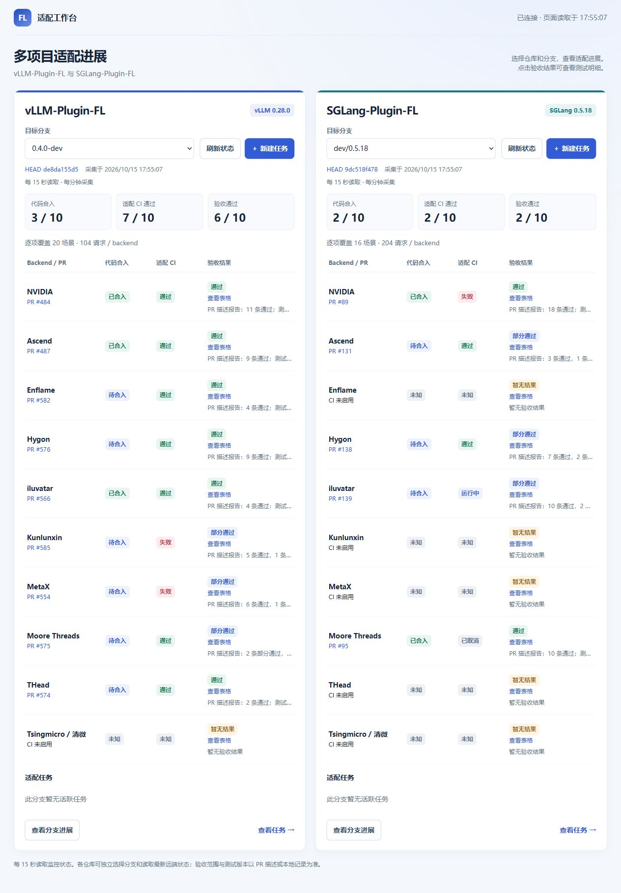

# FL 插件适配工作台

在同一页面跟踪 **vLLM-Plugin-FL** 和 **SGLang-Plugin-FL** 的适配进展，查看各 backend 的 PR、CI、验收结果和 agent 任务。



*当前版本总览快照（2026-10-15）。在线状态以最新采集结果为准。*

- 双仓库独立选择分支，结合 PR 标题与描述关联适配 PR；合入后继续跟踪，并核验合并提交属于所选分支。
- 本机从已采集设备中选择机器和 Codex、Claude 或 FlagScale Agent 即可创建任务；backend 按采集结果自动匹配，远端目录自动分配，补充说明可选。
- Codex 任务可在客户端继续同一会话，看板保留进展；长日志中的活跃任务持续显示。
- 验收结果优先读取 PR 描述，点击在页面内查看测试表格；保留本地存档与原生子会话进展。
- 本机登录 JumpServer 后刷新授权机器列表；也可沿用 SSH 配置，支持 Include。设备信息和最近读数保存在本地。
- 集成 [jms-top](https://github.com/lvyufeng/jms-top) 的多厂商资源采集：查看空闲卡、显存、负载及进程，按设备进入新建任务。
- 本机完整控制，局域网普通地址免登录只读；可生成定时或永久有效、随时可撤销的完整权限分享链接。

## 快速部署

准备 **Python 3.11+、Git**，下载本项目，并 clone 需要监控的插件仓库：[vLLM-Plugin-FL](https://github.com/flagos-ai/vllm-plugin-FL)、[SGLang-Plugin-FL](https://github.com/flagos-ai/sglang-plugin-FL)。插件 checkout 需包含所选 remote 的目标分支；首次 clone 后通常已有，缺少时先执行 `git fetch <remote>`。

看板使用 Python 标准库，**无需 pip 安装依赖或 GPU 环境**。建议安装并登录 `gh` 读取 GitHub 状态；执行适配任务时再准备 agent CLI、SSH 和远端 GPU 环境。

在本项目目录运行（Windows / Linux / macOS；系统只有 `python3` 时替换命令中的 `python`）：

```sh
python -B dashboard.py configure
python -B dashboard.py start
```

向导选择一个或两个项目，填写插件 checkout 路径、remote、目标分支和端口；自动生成配置后，启动器会检查配置及端口。打开 [本机看板](http://127.0.0.1:8766/)，保留启动终端；按 `Ctrl+C` 停止。端口冲突可用 `python -B dashboard.py start --port 9000`。

配置保存在 Git 忽略的 `runs/configured/`，各项目的会话与验收目录独立。向导不会覆盖已有配置；需要另一套配置时指定 `--output-dir`。已有 `projects.json` 的部署可继续使用原启动命令。迁移到另一台机器后重新运行向导，验收存档另行导入。

局域网部署沿用这份项目配置，单独启动免登录只读 HTTPS 服务。证书、防火墙、非交互配置及 Windows 登录后常驻的可复制步骤见 [部署指南](docs/DEPLOYMENT.md)。

## 页面入口

| 页面 | 用途 |
| --- | --- |
| `/` | 双仓库适配总览 |
| `/monitor?project=vllm` | 分支、PR、CI 和逐项验收详情 |
| `/sessions?project=vllm` | 验证机器、agent 配置与适配任务 |
| `/devices?project=vllm` | 设备资源、每卡状态与可用性（局域网免登录只读） |
| `/access-shares` | 本机创建、查看和撤销完整权限分享链接（需启用） |

版本标签随所选分支变化，读取该分支提交的 `pyproject.toml` 中对应引擎的精确依赖版本；尚未更新依赖声明的升级目标不会自动推断。

查看 SGLang 时将 `project=vllm` 改为 `project=sglang`。任务工作台提供「活跃 / 全部 / 回收站」视图，可搜索名称、分支或设备，按状态和 Agent 筛选。已结束的任务在「全部」中查看；删除任务会移入回收站，可恢复，工作目录和验收记录仍保留。运行中的任务须先中断。

代码合入、CI 和验收结果分别展示。验收结果汇总 PR 作者在描述中报告的测试结论：通过、部分通过、未通过或待验收，点击在当前页面展开验收表格，可继续查看原 PR。PR 暂无可识别结果时，使用关联同一 PR 的本地记录或逐项结果；原始场景和测试版本保留在分支详情中。

新建任务的“验证设备”读取设备资源页的采集记录。新机器先在资源页采集；过期记录会标明并在创建时重新核验，当前项目不支持的硬件标记为“仅资源监控”。如需手动指定 backend，可展开高级设置并启用“使用自定义连接与验收配置”。

设备资源页支持两种来源：在本机页面登录 JumpServer 后直接同步授权机器，或沿用已有 SSH 档案。无需安装 TUI。自动采集每 5 分钟一次，机器列表按需手动同步；打开页面先展示本地缓存。数据过期、重启后尚未核验或驱动异常时，不计为空闲。JumpServer 登录用于获取资产，实时资源采集还需可用的 SSH 网关认证；详见[设备配置](docs/REFERENCE.md#设备资源与-jms-top)。普通 LAN 地址可直接查看适配进展、设备及进程明细；访客读取缓存，不触发远端采集。资源刷新及任务操作需要本机或有效管理分享权限，JumpServer 登录与配置仅限本机。

## 更多配置

- [部署指南](docs/DEPLOYMENT.md)：配置向导、无人值守配置、HTTPS、免登录只读和后台常驻。
- [高级配置与验收参考](docs/REFERENCE.md)：agent 配置、原生任务接入、结果归档、命令编排与异常恢复。

Claude 与 FlagScale 的 API key 独立配置，使用 Windows 当前用户的 DPAPI 加密保存；普通局域网入口提供脱敏状态与验收表格。需要协作管理时，按[部署指南](docs/DEPLOYMENT.md#完整权限分享链接)启用分享，再从本机「访问分享」生成链接；持有者可创建、启动和管理任务，默认 24 小时到期，也可选择“永久有效（可撤销）”。

## 代码结构与扩展

业务代码位于 fl_dashboard/，按 monitoring、projects、agents、tasks、services、deployment 分工；页面在 web/templates/，示例配置在 examples/。根目录仅保留 dashboard.py 统一入口，命令脚本集中在 scripts/。新增同类仓库只需增加项目配置；新监控类型通过可信采集器注册接入，默认只读。详见 [结构与扩展指南](docs/ARCHITECTURE.md)。
