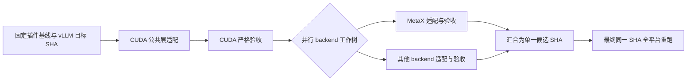

# vllm-plugin-FL 升级工作流：可配置首版

这个目录提供一个本地编排器和控制面板。它先在 CUDA 工作树中适配公共层并验收，再从该提交为其他 backend 建立独立工作树，并行运行配置中的适配命令和验收命令。面板由本地 HTTP 服务提供，可在 Codex 桌面端的内置 Browser 面板打开。

**当前是框架，不是一次已完成的插件升级。** `workflow.example.json` 中的仓库路径、commit 和模型清单必须替换；本目录未连接 GPU、未运行插件验收、未创建 PR。编排器只运行配置中明确给出的命令，不自动下载模型或配置远程机器。

## 流程与状态



本版实现 A 至 F。它在不同 backend 改出不同提交时返回 `ready_for_integration`，不会把各工作树单独通过误报为最终通过。G/H 应在合并改动后以集成提交重新启动一轮，或交给仓库现有的 GitHub Actions 多平台 CI。只有本轮全部平台在**同一提交**上通过，状态才是 `passed`。

每个平台都使用独立的 Git worktree。CUDA 基线成功后，其他 backend 从它的提交并行开始。状态保存在 `work_dir/state.json`；命令日志、验收证据、工作树也保存在 `work_dir`。失败的 backend 可在 CUDA 基线、配置和验收工具均未变时重试；重试创建新工作树并保留旧日志。适配若修改测试、CI 配置或其他受保护验收输入，会在快照前被拒绝。暂停只阻止后续阶段开始；运行中的命令继续执行。取消会终止本地子进程。

## 准备配置

需要 Python 3.10+、Git、插件仓库和目标 vLLM 源码 checkout。示例的适配命令使用 `codex exec`，因此实际运行它还需要已登录的 Codex CLI。执行 GPU 测试的环境需要对应的设备、驱动、依赖和模型文件。

1. 复制 `workflow.example.json` 为自己的 `workflow.json`。
2. 填写插件仓库根目录 `repo`、上游 vLLM 仓库根目录 `upstream_repo` 和独立的 `work_dir`。后者不能放在两个仓库内部。
3. 填写插件当前干净 checkout 的完整 `plugin_base_sha`，以及目标 vLLM ref 与它解析出的完整 `target_vllm_commit`。例如：`git -C <repo> rev-parse HEAD` 和 `git -C <upstream_repo> rev-parse "<target-ref>^{commit}"`。
4. 按设备填写每个平台的 `adapt_command`、`test_commands`、`device` 和 E2E case 清单。`cases.metax.example.json` 故意为空，填入实际可运行的 case 前，严格验收会失败。
5. 将远程 backend 的测试命令替换为自己的 SSH/CI 适配器。它必须让目标机器取得**当前工作树提交**、等待远端测试真正结束、将证据 JSON 写回本地 `{evidence_file}`。远端长任务用 tmux，SSH 命令不能只是启动会话就返回成功。取消远端任务也需要适配器处理。

配置中的命令是 argv 数组，不经过本地 shell。可用占位符包括 `{repo}`、`{upstream_repo}`、`{tool_dir}`、`{work_dir}`、`{worktree}`、`{platform}`、`{scope}`、`{attempt}`、`{target_vllm_ref}`、`{target_vllm_commit}`、`{plugin_base_sha}`、`{cuda_baseline_commit}`、`{plugin_commit}`、`{evidence_file}`。同名值也通过 `FLFLOW_*` 环境变量传给命令。`repo`、`upstream_repo`、`work_dir` 的相对路径按配置文件位置解析。

## 启动与控制

```text
python flflow.py validate --config workflow.json
python flflow.py start --config workflow.json --dry-run
python flflow.py serve --config workflow.json --host 127.0.0.1 --port 8765
```

`validate` 检查配置和仓库位置。`--dry-run` 还会检查插件基线及上游目标 SHA，但状态是 `simulated`，不算验收。服务启动后，在 Codex 内置 Browser 打开 `http://127.0.0.1:8765/`，用“启动、暂停后续阶段、继续、重试失败项、取消”控制运行，并查看每个平台日志。也可使用 CLI：`start`、`status`、`pause`、`resume`、`cancel`、`retry-failed`，均带 `--config workflow.json`。

本地控制接口只绑定 loopback。若以后通过反向代理在共享服务器提供控制台，应由代理提供认证和 HTTPS；不要把此服务直接暴露到公网。

## 长任务运行与异常恢复

运行中的工作线程属于 `serve` 进程。关闭浏览器页面不影响任务，但服务进程或承载它的终端退出时，线程可能中断，本地或远端子进程也可能继续运行；此时 `state.json` 可能仍显示 `running`，`run.lock` 可能残留。本版没有自动恢复或断点续跑。实际升级应让编排器在持久的终端或服务中运行；若运行主机支持 tmux，可用 tmux 承载 `serve`。远端 GPU 长任务也应由适配器放入 tmux，并等待任务真正结束后再返回结果。

异常退出后，按以下顺序检查：

1. 查看 `work_dir/state.json` 的 `run_id` 和状态、`work_dir/run.lock` 中的 PID，以及 `work_dir/logs/<run_id>/` 和 `work_dir/evidence/<run_id>/`。在编排器主机核对该 PID 的进程和命令行（Windows 可用 `Get-CimInstance Win32_Process -Filter "ProcessId = <pid>"`；Linux 可用 `ps -fp <pid>`），注意 PID 可能已被别的进程复用。
2. 按各 SSH/CI 适配器的记录检查本地子进程、远端 tmux 会话、远端日志及测试结果。若原编排器或测试任务仍在运行，先等待其结束，或按适配器的取消流程终止并确认已退出；不要删除锁文件后启动第二轮任务。
3. 只有确认原编排器已退出、所有关联的本地与远端任务均已结束后，才可备份本轮 `state.json`，并**仅删除** `work_dir/run.lock`。保留工作树、日志和证据供排查。然后用 `start` 启动新一轮；它会重置当前状态，不会接续中断处。`retry-failed` 仅适用于状态明确为 `failed` 且 CUDA 基线已通过的运行。

## 严格验收证据

每条测试命令必须写入配置指定的 JSON 证据文件。编排器要求 `platform`、`scope`、`target_vllm_commit`、`plugin_commit` 与当前任务完全一致，`status=passed`、`issues=[]`，且总计及每个非空 case 都满足 `executed=passed>0`、`failed=skipped=0`。命令退出码为零却没写证据、没有运行任何测试、任意 case 被跳过，都判为失败。证据文件在运行前删除，避免误用上次结果。

`strict_test.py` 是针对仓库 `tests/run.py` 的适配器，支持 unit、functional、e2e、benchmark。它对 E2E 清单中的每个 case 分别调用测试入口。当前一次入口调用只接受**一个** pytest 子进程；若 `tests/run.py` 发现多个 case，适配器会拒绝通过，避免后一个 JUnit XML 覆盖前一个而漏掉 skip。多个 benchmark case 需要扩展为逐子进程独立收集 JUnit，或改用能提供同等原子测试证据的自定义验收命令。E2E 必须给出非空、明确的 `task/model/case` 清单。它会核对插件工作树 HEAD 和已安装 vLLM 的版本；非标准目标 ref 还需为测试命令增加 `--expected-installed-version`。目前**不能**仅从 Python 包版本证明已安装 vLLM 的源码 commit，证据会如实标为 `vllm_commit_verified=false`；生产环境应另核对镜像 digest 或源码 SHA。真实验收不能使用上游测试入口的 `--dry-run` 或 `--save-gold`。示例把 benchmark smoke 当成必跑 scope；若目标平台尚未配置 benchmark case，零执行门禁会阻止通过。吞吐与时延相对旧版的数值阈值，以及仓库的 adaptation gate 场景，应在实际部署时增加为必跑门禁。

## 接入现有 CI 的建议

官方仓库已有 [多平台 CI](https://raw.githubusercontent.com/flagos-ai/vllm-plugin-FL/main/.github/workflows/ci.yml)、[平台测试编排](https://raw.githubusercontent.com/flagos-ai/vllm-plugin-FL/main/.github/workflows/_platform_test.yml) 和 [统一测试入口](https://raw.githubusercontent.com/flagos-ai/vllm-plugin-FL/main/tests/README.md)。截至 2026-09-24，[平台开关](https://raw.githubusercontent.com/flagos-ai/vllm-plugin-FL/main/.github/configs/platforms.yml)启用了 CUDA、Hygon、MetaX；这表示 CI 会调度这些平台，不代表任何新目标版本已经验收。生产版可以把本地编排器的远端测试命令改为触发或查询现有 CI，并在候选 PR 上做最终同 SHA 全平台门禁。

以明确的目标 tag 和完整 commit 为准。截至 2026-09-24，仓库主线的[测试依赖指向 vLLM 0.24.0](https://raw.githubusercontent.com/flagos-ai/vllm-plugin-FL/main/pyproject.toml)；本机已有的 setup 技能仍写 0.13.0，部分 worker 文件头写 0.19.0，均不能单独作为当前兼容版本的依据。真实 preflight 还应记录每台 GPU 机器实际安装的 vLLM/fork、PyTorch、FlagGems、驱动和模型版本。
