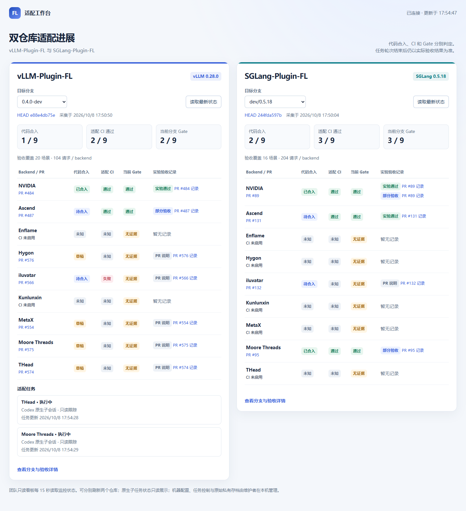

# FL 插件适配工作台

在同一页面跟踪 **vLLM-Plugin-FL** 和 **SGLang-Plugin-FL** 的适配进展，查看各 backend 的 PR、CI、Gate 和 agent 任务。



*只读总览快照。在线状态以最新采集结果为准。*

- 双仓库独立选择分支，自动关联规范命名的适配 PR。
- 本机通过 Codex 或 Claude 创建任务，查看进度、跟进和处理授权。
- 展示原生子会话与历史实验记录；有本地验收存档时优先打开，否则链接到 PR。
- 本机完整控制，局域网免登录只读。

## 快速部署

准备 **Python 3.11+、Git**，下载本项目，并 clone 需要监控的插件仓库：[vLLM-Plugin-FL](https://github.com/flagos-ai/vllm-plugin-FL)、[SGLang-Plugin-FL](https://github.com/flagos-ai/sglang-plugin-FL)。插件 checkout 需包含所选 remote 的目标分支；首次 clone 后通常已有，缺少时先执行 `git fetch <remote>`。

看板使用 Python 标准库，**无需 pip 安装依赖或 GPU 环境**。建议安装并登录 `gh` 读取 GitHub 状态；执行适配任务时再准备 agent CLI、SSH 和远端 GPU 环境。

在本项目目录运行（Windows / Linux / macOS；系统只有 `python3` 时替换命令中的 `python`）：

```sh
python -B configure.py
python -B start_dashboard.py
```

向导选择一个或两个项目，填写插件 checkout 路径、remote、目标分支和端口；自动生成配置后，启动器会检查配置及端口。打开 [本机看板](http://127.0.0.1:8766/)，保留启动终端；按 `Ctrl+C` 停止。端口冲突可用 `python -B start_dashboard.py --port 9000`。

配置保存在 Git 忽略的 `runs/configured/`，各项目的会话与验收目录独立。向导不会覆盖已有配置；需要另一套配置时指定 `--output-dir`。已有 `projects.json` 的部署可继续使用原启动命令。迁移到另一台机器后重新运行向导，验收存档另行导入。

局域网部署沿用这份项目配置，单独启动免登录只读 HTTPS 服务。证书、防火墙、非交互配置及 Windows 登录后常驻的可复制步骤见 [部署指南](DEPLOYMENT.md)。

## 页面入口

| 页面 | 用途 |
| --- | --- |
| `/` | 双仓库适配总览 |
| `/monitor?project=vllm` | 分支、PR、CI 和逐项验收详情 |
| `/sessions?project=vllm` | 验证机器、agent 配置与适配任务 |

查看 SGLang 时将 `project=vllm` 改为 `project=sglang`。任务列表默认只显示活跃任务；历史任务可在任务页查看。

代码合入、CI 和 Gate 分别展示。已有通过或部分验收记录的平台在概览 Gate 标注通过，具体测试范围和版本见记录详情。

## 更多配置

- [部署指南](DEPLOYMENT.md)：配置向导、无人值守配置、HTTPS、免登录只读和后台常驻。
- [高级配置与验收参考](docs/REFERENCE.md)：agent 配置、原生任务接入、结果归档、命令编排与异常恢复。

Claude API key 使用 Windows 当前用户的 DPAPI 加密保存；局域网入口只提供脱敏监控信息与 PR 链接。
