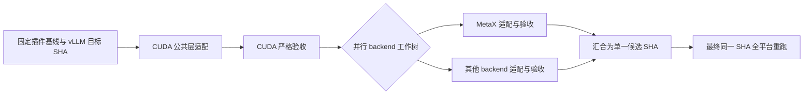

# 高级配置与验收参考

[返回项目首页](../README.md) · [部署与局域网访问](DEPLOYMENT.md)

本页保留任务接入、证据格式、命令编排和恢复操作的详细说明。日常启动请先阅读项目首页。

## 验收结果来源

总览将当前 Gate 与实验记录合并为一列“验收结果”。服务使用已获取的 PR 描述，识别测试结果表和明确的验证结论；不从 CI 徽标、计划清单、命令样例或非必需诊断推断实验通过。摘要列报告条目数，页面内表格列出测试项、配置、结果与状态；保留原 PR 作为补充来源，不把这些计数当作当前分支的逐项 Gate 数。

PR 描述中的明确未执行或未覆盖范围保留为待验收或部分通过。没有可识别结论时，依次使用与关联 PR 一致的本地验收记录、当前代码版本的逐项结果；缺少证据则显示暂无结果或 PR 记录。PR 描述属于作者报告，采集不会重新运行 GPU 实验。手动“读取最新状态”刷新描述，普通采集沿用五分钟 GitHub 缓存。

点击验收状态在当前页面打开明细表格，无需离开看板；弹窗内可打开原 PR，分支详情中的辅助记录可查看经哈希验证的本地存档及原始场景。局域网投影状态、摘要和最多 100 行净化后的验收表格；私有路径、地址、凭据和执行命令会被隐藏，不返回整篇 PR 正文或原始日志。

## 接入已有会话服务

已有控制服务仍在运行时，在本机监控配置增加 `sessions_api_url`，指向原服务的 loopback 地址，例如 `http://127.0.0.1:8765`。保留原服务作为会话存储的唯一管理者，新看板通过代理继续原任务。原服务不可达时会阻止新任务派发；适配任务统一从双仓库入口创建，以使用跨项目机器占用检查。

## 原生子会话与历史实验记录

总览与详情的任务列表只显示待启动、正在执行、等待回答或授权、正在中断的活跃任务。已完成、失败、已中断和断开连接的任务默认隐藏；任务页可以按需查看历史记录并继续原任务。任务记录与验收存档仍保留。

任务工作台将列表与详情分开，支持搜索、状态与 Agent 筛选。「全部」包含活跃和已结束任务。点击任务详情中的“删除任务”，确认后移入“回收站”；恢复保持原任务 ID，不自动启动。正在执行或等待处理的任务须先中断。删除只隐藏看板记录，不清理工作目录、事件日志、验收存档、远端 tmux 或 Codex 客户端会话；回收站不占用设备。原生观察任务需从监控配置管理，局域网入口仍不可删除或恢复任务。

Backend 名称统一采用“英文 / 中文”（例如 `NVIDIA / 英伟达`、`iluvatar / 天数智芯`），表格与任务设备选择保持一致。NVIDIA 固定在第一位，其余按英文名称排序。旧配置和证据的内部 `corex`、`musa` 等标识继续兼容。

已经在 Codex 桌面端启动的原生子会话可以通过监控配置中的 `external_tasks` 接入，使用 `id`、`title`、`backend`、`branch`、`thread_id`、`rollout_path` 字段；路径填写本机实际 JSONL 存档。观察器增量读取会话的开始、完成与更新事件，不接管或派发任务。同 backend 和分支的旧看板任务作为历史记录保留，新原生任务优先展示。轮次完成与 Gate 通过分别判定；缺少完整生命周期时显示未知，长时间没有更新时标明等待新状态。局域网仅展示 backend、分支、状态、阶段及更新时间，不返回原始消息、会话 ID、计划或本机路径。看板创建的 Codex / Claude / FlagScale 任务同样通过独立的文件观察器读取已保存状态；共享服务不连接任务执行器或 API 配置。

历史实验元数据放在 `<evidence_dir>/<backend>/records/<record-id>.json`，使用 `schema_version: 1`，填写 `id`、`engine`、`backend`、`branch`、`status`、`pr_number`、`title`、`summary`、`scope`。状态可为 `passed`、`partial`、`failed`、`reference`；已核对的版本可增加 `tested_commit`、`tested_tree` 和 `recorded_at`。原件保存为同目录内的 UTF-8 文件，通过 `archive: {"path": "<relative filename>", "sha256": "<64 hex characters>"}` 引用。

本机优先打开哈希验证成功的原件；文件缺失、越界或哈希不匹配时回退到该 PR 的页面。局域网提供净化后的验收表格和原 PR 链接，不开放原始私有存档。历史实验作为详情中的辅助记录保留；总览统一显示“验收结果”，优先使用 PR 描述。仅有 PR 链接的 `reference` 条目不会自动标注通过，原始逐项 Gate、测试范围和版本仍可在详情中核对。

## 选择 Codex、Claude 或 FlagScale Agent

新建任务可选择 `Codex`、`Claude` 或 `FlagScale Agent`。Codex 延续已有 CLI 登录、会话与代理服务；Claude 使用独立的本机 Claude Code CLI、工作树和会话目录，保留跨仓库的机器占用检查。Claude 默认运行目录为 `runs/<project>/claude-sessions`，不会把 Claude 请求转发给旧 Codex 服务。

Codex 启动前会重新定位当前 CLI；桌面端更新导致旧版本目录失效时，会自动查找当前程序。Windows 需要原生 `codex.exe`，仅有 `.cmd` / `.bat` 启动脚本时连接检查会报告不可用。默认配置向导不固定版本目录；自定义 `--codex-executable` 仍需维护该文件路径。

任务在创建会话前启动失败时，先点击“检查 Codex 登录”，恢复后在原任务详情点击“重试启动原任务”。重试保留任务 ID、已有工作目录和记录；已有会话则继续该会话。失败任务可在“全部”视图中找到。

本机 Codex 任务建立会话后，可以点击详情中的“在 Codex 中继续”。服务确认当前轮次已暂停后打开客户端中的原会话，保留任务 ID、工作目录和历史；远端 tmux 任务继续保留。交接后在客户端发送后续要求或处理授权，看板读取原生记录显示进展，并关闭对此任务的执行和审批控制。没有收到轮次结束确认时不会交接，避免两边同时执行。

新会话使用简洁的项目、backend 和分支标题，可在客户端任务列表中查找。使用官方支持的 [原会话深链接](https://learn.chatgpt.com/docs/reference/commands#deep-links)，仅本机开放交接入口；局域网继续只读。

在本机 `/sessions` 页配置 Anthropic API key、兼容 Anthropic 的 Base URL、模型、最大轮数和工具规则。API key 使用当前 Windows 用户的 DPAPI 加密后保存在忽略的 `runs/agent-settings` 中；页面只返回是否已配置，密钥不会回填到浏览器。更换 Windows 用户后需要重新配置。Base URL 默认使用 Anthropic 官方接口，自定义接口要求 HTTPS，loopback 调试接口可使用 HTTP。

Claude CLI 必须支持 `--bare`、`--output-format stream-json` 和 `--include-partial-messages`。任务以 print 模式运行，不加载已有宿主配置与 hooks。默认允许读取与文件编辑；需要执行命令时，在本机配置具体的 Bash 工具规则。工具被拒绝后，页面显示等待处理，可以修改规则再继续原任务；不会自动绕过权限。Claude 正在运行时须等待结束或先停止，再发送跟进要求。配置页保存及 CLI 检查不会发起模型调用，实际启动任务才使用 API。

本机的设置与任务控制接口仍受 loopback Host/Origin 检查保护；局域网入口不创建设置存储或 agent 执行器，免密码阅读不会开放新建任务或 API key 配置。

### FlagScale Agent

在运行看板的 Python 环境安装 [FlagScale Agent](https://github.com/flagos-ai/FlagScale-Agent)，或在本机监控配置填写 `flagscale_python`，指向已安装它的 Python。看板只执行兼容性检查，不在配置检查时调用模型 API。FlagScale 任务使用独立的 `runs/<project>/flagscale-sessions`，不会转发给现有 Codex 会话服务。

在任务页选择 FlagScale Agent，配置 `Anthropic` 或 `OpenAI 兼容` API 协议、匹配的 Base URL、模型和 API key。它的 key 与 Claude 独立，并以当前 Windows 用户 DPAPI 加密保存在忽略的运行目录。留空保留已有 key，移除按钮只删除当前 provider 的 key。任务请求、命令参数和运行记录均不包含 key。

支持创建、启动、进展、事件、中断及跟进。跟进沿用同一工作树和已保存的任务上下文，开启新的原生 FlagScale 执行轮次；当前上游单次执行接口不提供原生会话续接或运行中插入消息。每轮时间预算用于提醒与收尾，不会在时间到达时强制停止进程。Agent 轮次完成与实际 Gate 验收独立判定。

## SGLang 原始结果归档

`sglang_evidence.py` 在验证机器的干净候选 checkout 上调用原始 example / 并发测试函数，保存实际请求输入、原始输出、源文件 Git blob、模型、运行模式、插件激活状态和逐请求校验。脚本应放在候选仓库外的独立工具目录，以免其副本使候选 checkout 变脏。每个模型执行完整的一组，用不同 `output-dir` 分开保存：

```text
python -B <tools>/sglang_evidence.py --repo <clean-candidate> --branch <baseline-branch> --commit <tested-sha> --backend <backend> --model-path <actual-model-path> --mode eager --scenario all --output-dir <evidence-root>/<model>/eager
```

`--scenario all` 根据指定提交读取该模型的全部源码场景；原始脚本的 graph 设置决定可用模式。示例基线中的两个模型各有 8 个场景、102 个请求，合计 16 场景、204 请求。原生 pytest YAML 的实际模型路径必须与提供的模型路径一致，采集器不会修改测试或模型配置。模型/请求输入、源码提交或插件激活状态无法核对时保留失败记录。

归档使用独立格式：`manifest.json` 的 `engine` 为 `sglang`，场景 JSON 的 `evidence_type` 为 `sglang_raw_requests`，包含 `case`、`execution`、`requests`、`summary`。将整个 `<run_id>/` 原样导入此项目配置的证据目录；面板重新检查源码定义与每个请求，不能凭退出码、CI 或自报 `passed` 判定通过。完整验收要求同一模型/模式最新一轮覆盖全部场景；部分重跑不会借用较旧完整轮次的缺项。复用 `run-id` 时身份不一致或场景已存在会拒绝覆盖。此项目的页面与采集器检查不等于已在 GPU 上完成验收。

## 分支适配监控

将 `examples/branch-monitor.example.json` 复制为 `branch-monitor.json`，核对插件仓库路径、remote、分支、模型和 backend PR 编号。启动 `python scripts/flflow.py serve --config workflow.json --monitor-config branch-monitor.json` 后，首页 `/` 显示分支监控；原工作流控制页在 `/workflow`。页面可切换本地 remote-tracking 分支，并用“读取最新状态”更新目标分支 Git ref 与 GitHub CI。`branch-monitor.json` 是本机配置，已被 Git 忽略。

监控服务优先通过已登录的 `gh api` 读取 GitHub 状态；若未安装或不可用，则用 GitHub HTTP API（可通过 `GH_TOKEN` 或 `GITHUB_TOKEN` 提高配额）。远端接口数据缓存 5 分钟。完整监控结果按仓库配置和分支分别缓存并落盘；重新打开页面或重启服务时，先显示最近一次完整结果，再按原有周期在后台采集。页面每 15 秒读取状态，明确标注缓存、后台更新及上次采集时间；首次尚无记录时显示采集中。点击刷新会立即请求采集；网络故障或结果不完整时保留上次完整结果，不把旧记录的时间改成当前时间。

监控缓存存放在 `resource_state_dir` 下的 `monitor-snapshots/`；未配置时使用 `sessions_dir`，再回退到验收目录的上级目录。无需额外设置。本机与局域网公开快照分别保存，公开快照经过字段筛选；缓存不包含任务会话或登录凭证。每个监控最多缓存 12 个分支，配置变化会隔离旧缓存，损坏的缓存不会阻止服务启动。

默认根据 PR 标题和正文的 Summary / Description / 概述等目的段落识别 backend 适配。接受明确的适配、升级标题，或明确说明将插件、vLLM、SGLang 适配到某 backend 的正文。分支名称仅用于冲突检查，不能单独证明适配；测试表格、代码块、引用和 HTML 注释不作为适配目标。普通算子修复、CI 调整及仅提及某设备的 PR 不自动关联。规则采用保守文本匹配，描述不明确时由维护者指定 PR 编号。

候选及显式配置的 PR 都必须由 GitHub 详情确认其目标分支（base.ref）与页面所选分支完全一致；旧分支的 PR、CI 和验收引用不会带入新分支，无法确认目标分支时不显示该 PR。适配目标必须唯一；多个候选不自动选择。已明确配置的打开 PR 和已验证合入当前分支的 PR 保持优先。backend_pr_discovery 的 head_prefixes 和可选 title_terms 是维护者显式覆盖规则。corex 与 iluvatar 视为同一 backend。PR 关联、合入状态、CI 和验收记录分别判定，描述中的通过结果不会覆盖真实 CI 状态。

适配 CI 只汇总对应 backend 的测试，准备步骤和通知不参与判定，其他 backend 的失败不会影响它。PR 合入目标分支并验证合入提交后，继续显示该适配 PR 原提交的测试结果；后续分支的同 backend CI 在展开详情中单独显示。缺少测试记录时显示未知，代码合入本身不代表测试通过。显式配置的已验收 CI 运行仍校验测试提交、运行次数与当前代码树。

监控清单从**所选分支**的 `.github/configs/platforms.yml` 和 `tools/adaptation-gate-cases/test_*.py` 读取。当前 `0.4.0-dev` 的 gate 包含两个 Qwen3.6 模型、eager/graph 两种模式、每组 5 个 pytest 场景（合计 20 个场景、104 个请求）。代码已合入、CI 成功和 Gate 通过是三个独立状态。直接验收结果由运行清单绑定 backend、实际测试提交、模型、模式和端口，再检查每个 JSON 的逐请求结果。历史验收记录会单独标注来源和接受版本，不会伪装成当前 HEAD 的新一轮测试；本机演示结果也不会计入分支监控。

要让 Gate 显示真实结果，在 `evidence_dir` 下为每次 backend / 模型 / 模式运行放一个 `manifest.json`，并把 `tools/adaptation-gate-cases` 写出的 5 个场景 JSON 放在清单指定的 `results_dir`。例如 `runs/gate-evidence/cuda/Qwen3.6-27B/eager/run-001/manifest.json`：

```json
{
  "schema_version": 1,
  "run_id": "run-001",
  "backend": "cuda",
  "branch": "0.4.0-dev",
  "commit": "e88e4db75ece36e482a5fcc288929d4461d53184",
  "model": "Qwen3.6-27B",
  "mode": "eager",
  "port": 8000,
  "results_dir": "results"
}
```

`results_dir` 相对清单所在目录。只有清单的 commit 等于所选分支 HEAD、五个 JSON 全部对应当前 case 且每个请求的检查均通过，该模型 / 模式下的五个 case 才会显示通过。完整 backend Gate 还需两个模型的两种模式全部通过。当前仓库不自动从 GPU 或 CI 下载这些 JSON。

截至 2026-09-24，`0.4.0-dev` 已合入 [NVIDIA 适配 PR #484](https://github.com/flagos-ai/vllm-plugin-FL/pull/484)。验收版本 `5e95688` 的 [CI run 35199866402（attempt 2）](https://github.com/flagos-ai/vllm-plugin-FL/actions/runs/35199866402) 全部 NVIDIA 测试通过；该版本与合入提交 `e88e4db` 的完整 Git tree 相同。之后合入提交的 [CI run 35660209641](https://github.com/flagos-ai/vllm-plugin-FL/actions/runs/35660209641) 失败，面板单独显示这次分支 CI，保留已通过的适配验收记录。

NVIDIA Gate 的四组 5/5 结果见 [PR #492](https://github.com/flagos-ai/vllm-plugin-FL/pull/492) 和 PR #484。原始 20 份 JSON 已在本机证据目录归档，逐项核验为 **20/20 场景、104/104 请求通过**。这些结果于 2026-09-16 在 A800 TP2 上运行，使用 `d98ebec` 导出源码加后来提交为 `630d96a` 的 `scatter_` 修复。它们是升级 PR 接受的历史验收证据，不是在最终 HEAD 上重新执行的结果；原始执行版本与验收版本分别记录。原始数据和本机配置均不提交到本仓库。

Ascend、MetaX 和 iluvatar 等候选 PR 显示在各自 backend 行。候选工作分支通过测试后，应按**实际测试的 commit** 收集 Gate JSON；PR 尚未合入时，该结果不能表示目标分支已通过验收。

## 日常适配任务

启动服务后打开 `/sessions`。先安装并登录本机 Codex CLI；服务使用官方 [Codex app-server](https://developers.openai.com/codex/app-server/) 协议创建、继续和监控会话。需要时可在 `branch-monitor.json` 设置 `codex_executable` 的完整路径。页面中的“检查连接”会检查 CLI 和登录状态。

日常新建任务选择**设备和 Agent**，确认**基线分支**，可选填写补充说明。基线分支默认沿用监控页所选分支或项目默认分支，下拉栏列出已同步的远端分支，选择“输入其他分支…”可手动填写，无需启用高级设置。分支列表直接读取本地远端引用，不等待 PR/CI 采集，也不会覆盖正在填写的分支；任务创建后固定基线提交。设备来自部署用户的 SSH 配置及已保存机器档案。首次使用先在本机完成 Agent 登录或 API 配置，并在终端核对设备主机指纹、配置非交互 SSH 登录。配置只引用密钥文件，页面不接收密码或私钥内容。

刷新任务页会重新读取部署用户的 `~/.ssh/config` 及 Include 文件，也可以点击“同步 SSH 配置”。新增的明确 Host 别名自动进入列表；删除的导入别名退出当前列表，原任务仍保留引用。已有别名的 HostName、User、Port 等变更会立即更新连接预览，使旧连通性/环境检查失效；下次自动创建重新探测所选设备，高级手工模式需重新检查。同步只读取配置与密钥路径，不读取私钥内容或执行 SSH 命令。

同步会根据 SSH 名称中的厂商或明确型号归类设备，名称含糊、歧义或无匹配时标记“无法识别”；名称推断会注明待硬件核验，自动任务仍读取实际硬件确认。相同导入别名只显示一次，优先保留已有配置及开发机、跳板机限制；同步结果显示新增、更新、移除和识别数量。自动导入保留手工填写或已确认的 backend、远端目录、模型路径、硬件和名称，不覆盖手工添加的直接连接。新别名可直接用于自动任务，无需先手填 backend 或远端目录。同步更新列表时保留正在编辑的表单。可用监控配置 `ssh_import_config` 指定其他 SSH 配置文件；该路径只由本机配置决定，API 不接受客户端文件路径。

自动创建只探测本次选择的设备，获取远端用户目录和硬件信息，并有界查找本项目已有 checkout。系统为每项任务分配远端 `~/.flflow/tasks/<project>/<task>/candidate` 目录；已有 checkout 仅作为参考来源，Agent 使用 tmux 准备独立代码目录、查找模型并检查环境，然后执行适配与验收。硬件无法可靠确认或 SSH 失败时会报告诊断，不会猜测 backend 或显示已准备成功。

特殊情况可展开高级设置，并勾选“使用自定义连接与验收配置”，填写连接、backend、已有远端目录或模型路径，使用原有保存与预检流程。仅展开高级设置不会切换到手工模式。“仅创建，稍后启动”固定基线并建立本地独立 worktree，远端代码由 Agent 启动后准备。同一 SSH 别名或同一直接连接的主机、用户、端口只允许一个待启动或活动任务；不同机器可并行跟进不同 backend。

创建并启动后默认留在任务页；勾选“启动后进入监控页”可切换到分支监控。适配任务每 3 秒读取一次，显示 agent 报告的实际计划、最新消息、异常和待处理授权/提问；可以在监控页答复、发送补充指令、中断或继续任务，并打开详情查看事件日志。agent 指令要求跟进环境检查、适配、服务启动、原仓库 `tools/adaptation-gate-cases` 验收与证据归档。浏览器关闭不会取消后台执行；服务进程仍需保持运行。

机器列表分别显示最近一次 SSH 连通检查和完整环境预检，附检查时间及失败原因。Windows 向远端发送预检脚本时使用 UTF-8 字节保留 LF；SSH 已通过但远端检查脚本失败时，页面单独报告环境检查失败。修改连接参数会使原连接检查失效；只修改备注不会丢失检查记录。

实际计划来自 Codex 的计划通知；会话没有计划工具时，agent 在自己的隔离工作目录维护 `.flflow-progress.json`。服务只接受身份与 backend 一致的有界进度文件，页面标注来源和更新时间。进度摘要、阶段完成以及“本轮结束”都不会改变 CI 或 Gate 结果。`backend_labels` 中明确配置的 backend 即使尚无 CI、PR 或证据，也会留在状态表中。

任务页显示实时事件和输出，可发送补充指令、回答提问，并逐次确认命令、文件或权限请求。事件日志和 Codex thread ID 保存在本机 `sessions_dir`（默认 `runs/codex-sessions`），服务重启后可从页面继续已有会话。页面通过自己的 app-server 连接管理任务，不保证自动出现在 Codex 桌面侧栏或与侧栏状态同步。

机器清单按 backend 分组，保存硬件说明、识别依据和备注。导入配置时可以暂缺 backend 或远端目录，自动创建时确认设备类型并分配任务目录。跳板机仅作为连接入口展示。根据别名推断的硬件应标记待核实；机器配置保存在被 Git 忽略的本机运行目录。

“中断当前执行”中断 Codex 当前轮次；远端 tmux 安装、服务或测试仍可能运行。页面对活跃 Codex 任务的机器占用检查不能证明远端作业已经停止，复用机器前须检查实际 tmux 和 GPU 状态。任务会先检查环境，再进行适配和验收；一轮对话结束不等于升级完成或 Gate 通过。收集结果时应保留实际测试提交、模型、模式、命令、时间和原始 JSON，并按上面的证据格式导入分支面板。

`/workflow` 保留基于配置命令的编排器。运行前需将 `examples/workflow.example.json` 中的仓库路径、commit、命令和模型清单替换为真实配置；它只运行明确配置的命令。

### 任务归属与执行位置

对于已有适配 PR 的 backend，在本地监控配置的 `backend_task_policies` 中设置 `mode: "monitor"`，并可填写 `pr` 和 `reason`。策略的 `branch` 省略时使用配置中的默认分支；仅对该基线分支生效。未配置的 backend 保持 `adapt` 模式。

仅监控模式允许查看进展、PR、CI 和 Gate，以及中断旧会话或拒绝待审批操作；服务端会拒绝创建、启动、继续和补充适配指令。相同基线分支与 backend 的任务应继续已有 session，不能通过更换机器或结束一轮对话重复派发。

页面分别显示基线分支和提交、独立工作分支、本地 worktree，以及机器配置中的源目录。实际候选提交和远端任务目录尚未结构化上报时显示待核对，不能将基线提交当作测试候选。每个 backend 的环境、远端 tmux 和原始验收证据都应保留在自己的任务目录。

进度文件可增加可选 `provenance` 对象，记录实际观察到的候选和远端任务目录。填写示例中的占位值，并沿用文件顶层的真实 `session_id`、`backend`、`schema_version: 1`：

```json
{
  "provenance": {
    "branch": "<本 session 的基线分支>",
    "candidate_commit": "<实际候选的完整 40 位十六进制 SHA>",
    "remote_task_workspace": "/work/backend-task",
    "observed_at": "<原始观察时间，RFC3339 格式且带时区>",
    "evidence_paths": [{"path": "evidence/identity.json"}]
  }
}
```

服务端要求分支与 session 一致，远端任务目录为长度不超过 2000 的 Linux 绝对路径，不含控制字符或 `..`，且不能以 `//` 开头。每份记录最多引用 20 个证据文件；`path` 最多 512 字符，使用 worktree 内已有文件的相对路径和 `/` 分隔符，不含空、`.` 或 `..` 组件，禁止越界及指向目录外的链接，每项可附完整 64 位十六进制 `sha256`。引用及哈希只作为 agent 上报记录，服务不会执行远端检查、读取文件内容来核对哈希或据此判定 Gate。

API 将有效记录放在 `session.reported_provenance`，保留上述字段并添加 `source: "agent_report"`。`observed_at` 必须是有效日期的 RFC3339 时间：大写 `T` 分隔日期和时间，显式使用 `Z` 或 `±HH:MM` 时区，可含 1–9 位小数秒；不接受空格分隔、无时区或闰秒。允许最多 5 分钟的时钟偏差；未来异常时间、非法或较旧记录会被忽略，缺失记录也不会清空已接受的记录。候选身份按观察时间独立更新，不受计划通知的优先级影响；更新摘要或复制文件的时间不会刷新证据时间。服务不从自由文本或旧的候选字段推断 provenance，也不会改变机器配置中的源目录、Codex 轮次状态或验收判定。

审批按钮仅展示当前请求支持的单次决定；请求只支持 `cancel` 时，按钮标注“拒绝并结束本轮”，结束后可在原 thread 继续。页面不提供永久执行策略授权。

## 流程与状态



本版实现 A 至 F。它在不同 backend 改出不同提交时返回 `ready_for_integration`，不会把各工作树单独通过误报为最终通过。G/H 应在合并改动后以集成提交重新启动一轮，或交给仓库现有的 GitHub Actions 多平台 CI。只有本轮全部平台在**同一提交**上通过，状态才是 `passed`。

每个平台都使用独立的 Git worktree。CUDA 基线成功后，其他 backend 从它的提交并行开始。状态保存在 `work_dir/state.json`；命令日志、验收证据、工作树也保存在 `work_dir`。失败的 backend 可在 CUDA 基线、配置和验收工具均未变时重试；重试创建新工作树并保留旧日志。适配若修改测试、CI 配置或其他受保护验收输入，会在快照前被拒绝。暂停只阻止后续阶段开始；运行中的命令继续执行。取消会终止本地子进程。

## 准备配置

需要 Python 3.11+、Git、插件仓库和目标 vLLM 源码 checkout。示例的适配命令使用 `codex exec`，因此实际运行它还需要已登录的 Codex CLI。执行 GPU 测试的环境需要对应的设备、驱动、依赖和模型文件。

1. 复制 `examples/workflow.example.json` 为自己的 `workflow.json`。
2. 填写插件仓库根目录 `repo`、上游 vLLM 仓库根目录 `upstream_repo` 和独立的 `work_dir`。后者不能放在两个仓库内部。
3. 填写插件当前干净 checkout 的完整 `plugin_base_sha`，以及目标 vLLM ref 与它解析出的完整 `target_vllm_commit`。例如：`git -C <repo> rev-parse HEAD` 和 `git -C <upstream_repo> rev-parse "<target-ref>^{commit}"`。
4. 按设备填写每个平台的 `adapt_command`、`test_commands`、`device` 和 E2E case 清单。`examples/cases.metax.example.json` 故意为空，填入实际可运行的 case 前，严格验收会失败。
5. 将远程 backend 的测试命令替换为自己的 SSH/CI 适配器。它必须让目标机器取得**当前工作树提交**、等待远端测试真正结束、将证据 JSON 写回本地 `{evidence_file}`。远端长任务用 tmux，SSH 命令不能只是启动会话就返回成功。取消远端任务也需要适配器处理。

When pinning source file byte length or SHA across Windows/Linux, use the fixed commit Git blob raw bytes (`git show <commit>:<path>`), and independently check the actual remote provider. Working-tree copies may convert line endings; never silently normalize mismatches to pass a guard. One matching file does not refresh the complete source observation clock.

配置中的命令是 argv 数组，不经过本地 shell。可用占位符包括 `{repo}`、`{upstream_repo}`、`{tool_dir}`、`{work_dir}`、`{worktree}`、`{platform}`、`{scope}`、`{attempt}`、`{target_vllm_ref}`、`{target_vllm_commit}`、`{plugin_base_sha}`、`{cuda_baseline_commit}`、`{plugin_commit}`、`{evidence_file}`。同名值也通过 `FLFLOW_*` 环境变量传给命令。`repo`、`upstream_repo`、`work_dir` 的相对路径按配置文件位置解析。

## 启动与控制

```text
python scripts/flflow.py validate --config workflow.json
python scripts/flflow.py start --config workflow.json --dry-run
python scripts/flflow.py serve --config workflow.json --host 127.0.0.1 --port 8765
```

`validate` 检查配置和仓库位置。`--dry-run` 还会检查插件基线及上游目标 SHA，但状态是 `simulated`，不算验收。服务启动后，在 Codex 内置 Browser 打开 `http://127.0.0.1:8765/` 查看分支监控，打开 `/sessions` 跟进 Codex 任务，或在 `/workflow` 用“启动、暂停后续阶段、继续、重试失败项、取消”控制编排器并查看日志。编排器也可使用 CLI：`start`、`status`、`pause`、`resume`、`cancel`、`retry-failed`，均带 `--config workflow.json`。

本地控制接口只绑定 loopback。若以后通过反向代理在共享服务器提供控制台，应由代理提供认证和 HTTPS；不要把此服务直接暴露到公网。

团队只查看进展时，可部署独立的 `share_server.py`。它提供经过脱敏的监控数据，并关闭任务控制和原始私有数据接口。局域网可使用 `--anonymous-lan` 免登录阅读，仍保留 HTTPS 与后端只读限制；本机完整控制台使用独立的 loopback 入口。需要协作管理时可额外启用定时或永久有效、可撤销的完整权限分享链接，普通 LAN 地址继续只读。部署与访问入口配置见 [部署与局域网访问](DEPLOYMENT.md)。

## 长任务运行与异常恢复

以下恢复步骤适用于 `/workflow` 编排器。它的工作线程属于 `serve` 进程。关闭浏览器页面不影响任务，但服务进程或承载它的终端退出时，线程可能中断，本地或远端子进程也可能继续运行；此时 `state.json` 可能仍显示 `running`，`run.lock` 可能残留。编排器没有自动恢复或断点续跑，应运行在持久的终端或服务中；若主机支持 tmux，可用 tmux 承载 `serve`。远端 GPU 长任务也应由适配器放入 tmux，并等待任务真正结束后再返回结果。`/sessions` 的 Codex 会话恢复见上一节。

异常退出后，按以下顺序检查：

1. 查看 `work_dir/state.json` 的 `run_id` 和状态、`work_dir/run.lock` 中的 PID，以及 `work_dir/logs/<run_id>/` 和 `work_dir/evidence/<run_id>/`。在编排器主机核对该 PID 的进程和命令行（Windows 可用 `Get-CimInstance Win32_Process -Filter "ProcessId = <pid>"`；Linux 可用 `ps -fp <pid>`），注意 PID 可能已被别的进程复用。
2. 按各 SSH/CI 适配器的记录检查本地子进程、远端 tmux 会话、远端日志及测试结果。若原编排器或测试任务仍在运行，先等待其结束，或按适配器的取消流程终止并确认已退出；不要删除锁文件后启动第二轮任务。
3. 只有确认原编排器已退出、所有关联的本地与远端任务均已结束后，才可备份本轮 `state.json`，并**仅删除** `work_dir/run.lock`。保留工作树、日志和证据供排查。然后用 `start` 启动新一轮；它会重置当前状态，不会接续中断处。`retry-failed` 仅适用于状态明确为 `failed` 且 CUDA 基线已通过的运行。

## 严格验收证据

每条测试命令必须写入配置指定的 JSON 证据文件。编排器要求 `platform`、`scope`、`target_vllm_commit`、`plugin_commit` 与当前任务完全一致，`status=passed`、`issues=[]`，且总计及每个非空 case 都满足 `executed=passed>0`、`failed=skipped=0`。命令退出码为零却没写证据、没有运行任何测试、任意 case 被跳过，都判为失败。证据文件在运行前删除，避免误用上次结果。

`strict_test.py` 是针对仓库 `tests/run.py` 的适配器，支持 unit、functional、e2e、benchmark。它对 E2E 清单中的每个 case 分别调用测试入口。当前一次入口调用只接受**一个** pytest 子进程；若 `tests/run.py` 发现多个 case，适配器会拒绝通过，避免后一个 JUnit XML 覆盖前一个而漏掉 skip。多个 benchmark case 需要扩展为逐子进程独立收集 JUnit，或改用能提供同等原子测试证据的自定义验收命令。E2E 必须给出非空、明确的 `task/model/case` 清单。它会核对插件工作树 HEAD 和已安装 vLLM 的版本；非标准目标 ref 还需为测试命令增加 `--expected-installed-version`。目前**不能**仅从 Python 包版本证明已安装 vLLM 的源码 commit，证据会如实标为 `vllm_commit_verified=false`；生产环境应另核对镜像 digest 或源码 SHA。真实验收不能使用上游测试入口的 `--dry-run` 或 `--save-gold`。示例把 benchmark smoke 当成必跑 scope；若目标平台尚未配置 benchmark case，零执行门禁会阻止通过。吞吐与时延相对旧版的数值阈值，以及仓库的 adaptation gate 场景，应在实际部署时增加为必跑门禁。

## 接入现有 CI 的建议

官方仓库已有 [多平台 CI](https://raw.githubusercontent.com/flagos-ai/vllm-plugin-FL/main/.github/workflows/ci.yml)、[平台测试编排](https://raw.githubusercontent.com/flagos-ai/vllm-plugin-FL/main/.github/workflows/_platform_test.yml) 和 [统一测试入口](https://raw.githubusercontent.com/flagos-ai/vllm-plugin-FL/main/tests/README.md)。截至 2026-09-24，[平台开关](https://raw.githubusercontent.com/flagos-ai/vllm-plugin-FL/main/.github/configs/platforms.yml)启用了 CUDA、Hygon、MetaX；这表示 CI 会调度这些平台，不代表任何新目标版本已经验收。生产版可以把本地编排器的远端测试命令改为触发或查询现有 CI，并在候选 PR 上做最终同 SHA 全平台门禁。

以明确的目标 tag 和完整 commit 为准。截至 2026-09-24，仓库主线的[测试依赖指向 vLLM 0.24.0](https://raw.githubusercontent.com/flagos-ai/vllm-plugin-FL/main/pyproject.toml)；本机已有的 setup 技能仍写 0.13.0，部分 worker 文件头写 0.19.0，均不能单独作为当前兼容版本的依据。真实 preflight 还应记录每台 GPU 机器实际安装的 vLLM/fork、PyTorch、FlagGems、驱动和模型版本。

SGLang 与 vLLM 使用相同的 backend CI 判定：只汇总关联 PR 提交上该 backend 的测试，不受其他 backend、通知或整体 workflow 结论影响。没有该 backend 的测试保持未知，取消或失败不算通过；旧提交的验收记录不覆盖新提交 CI。PR checks 超过一页时继续读取，避免漏掉目标设备测试。SGLang 的 feat(backend) 升级/运行时适配标题、以设备名称开头的升级描述以及 MThreads/MUSA 别名均支持自动发现。

## 设备资源与 jms-top

所有局域网访客均可打开 `/devices?project=vllm`（SGLang 改为 `project=sglang`），按设备名称、backend 和状态筛选，查看每张卡的利用率、显存及进程。本机或有效管理分享额外显示采集与“新建任务”操作，新建任务时会预选对应设备。

**JumpServer 设备来源**：在本机设备页填写平台根地址（例如 `https://jumpserver.example.org`）、用户名和密码，点击登录并同步。两个项目共用授权机器列表；后续点击“刷新机器列表”更新新增、移除或变更的授权，无需维护本地 SSH Host。设备列表和新任务会排除平台标记停用的资产；已停用的旧记录不再参与采集，已有任务历史仍保留。停用状态由平台资产字段判断，不按名称或地址合并设备。页面登录独立于浏览器中已有的 JumpServer 登录。密码只用于换取令牌，不保存；Windows 使用当前用户 DPAPI 加密令牌，其他系统仅在内存保留令牌。

资产 API 登录和 SSH 连接是两个步骤。资源采集及远端任务使用 KoKo 网关，默认采用平台域名、端口 `2222` 和本机 SSH agent / 默认密钥；实际网关不同或需要专用密钥时，在连接配置中填写。平台需允许 SSH 密钥认证；只支持密码/MFA 交互的 SSH 网关暂不能自动采集。监控不会自动信任未知主机密钥。

已有登录凭据时，连接设置显示平台、账号与凭据状态，隐藏登录表单；同步失败可直接重试，凭据失效后再登录。设备账号下拉框仅列出平台授权账号及覆盖数量。资源采集账号（`default_account`）与任务执行账号（`task_account`）分别保存；例如使用普通账号查看资源、管理账号执行任务。显式选择后只连接已授权该账号的资产，不会自动改用其他账号；未指定时才自动选择唯一账号。旧配置未设置任务账号时沿用采集账号。监控使用临时独立 SSH 配置，不改写任务连接；保存账号后会刷新资源，无需再次输入平台密码。

登录、平台设置和资产同步接口仅允许本机管理；有效管理分享可刷新已配置设备的资源。匿名设备页仅轮询已有缓存，不触发 SSH 采集或任务操作，也不返回连接凭据和配置。切换回 SSH 来源后沿用已有档案，支持 Include；跳板机、开发机不作为计算设备采集。切换来源、修改连接或授权失效时，旧读数立即取消可用标记，已有任务历史仍保留。

**本地缓存**：授权资产及最近一次型号、卡数、显存、负载和采集时间落盘；历史进程列表、原始命令输出和密码不写入资源缓存。页面先显示缓存，采集过程中保留上次指标和原始采集时间；后台每完成一台即替换该设备的读数，失败时继续显示历史数据。同一平台和账号刷新机器列表、重启服务后均可复用缓存；切换平台、登录账号或设备连接时隔离历史，新清单中移除的设备同步退出列表。正常读数超过 10 分钟标为过期；服务重启后的历史记录始终标为待确认，重新采集前空闲容量为零。缓存损坏不会阻止服务启动。默认存放在会话目录下的 `device-resources/`；可在任一项目 monitor 配置中设置绝对路径 `resource_state_dir`，将缓存和加密登录状态统一放到指定目录。多项目控制器与独立任务 owner 使用各自子目录，避免来源设置互相影响。该目录应位于 Git 仓库之外或忽略目录中。

已有独立 `sessions_api_url` 任务 owner 的部署：在控制器与 owner 的 monitor 配置中设置相同的绝对路径 `sessions_owner_token_file`。首次启动自动生成内部通信凭据（Windows 为 DPAPI 密文，POSIX 为私有文件），只用于本机服务间访问完整历史档案；分享网关不会转发该凭据。先重启 owner，再重启控制器。单进程部署不需要此项。

页面自动刷新默认每 5 分钟一次，授权资产列表只在登录或手动同步时请求平台。页面状态轮询只读取服务缓存，不触发 SSH。后台采集默认最多 12 台并行，两个项目共用并发池，同一连接的采集请求及刚完成结果会复用；慢设备独立超时，其他设备完成后立即更新。单次采集最多等待 45 秒；连接中断、超时或缺少有效响应会错峰重试一次，认证和主机密钥错误直接报告。已经连上设备但采集命令失败时显示可用性待确认，不再误标设备离线。页面显示进度、实际采集数和排队数。可在 monitor 配置中设置 `"device_probe_workers": 12`（1–32，重启生效）；多项目配置不一致时取较小的显式值作为全局上限。正在采集时仍保留缓存；隐藏页面或暂停自动刷新后，不再自动提交新采集，也可随时点击“立即刷新”。每次 SSH 仅执行固定的管理工具和系统计数器读取，不安装包、不启动模型、不杀进程，也不会调用可选模型接口或发送飞书消息。

| 状态 | 含义 |
| --- | --- |
| 空闲 | 加速器信号确认空闲，节点负载符合条件 |
| 部分可用 | 部分卡空闲，或卡空闲但节点负载偏高 |
| 忙碌 | 进程、显存或计算使用达到占用条件 |
| 显存残留 | 高显存占用但未观测到对应进程 / 计算信号 |
| 可用性待确认 / 已过期 | 缺少完整指标或进程信息、工具查询失败或数据过旧；页面展示具体原因 |
| 离线 | 当前 SSH 连接不可用，页面显示可处理的连接原因 |

采集使用设备上已有的厂商管理工具，只读取资源与进程信息：

| 设备 | 采集命令 |
| --- | --- |
| NVIDIA | `nvidia-smi --query-gpu=...`、`--query-compute-apps=...` |
| AMD（超威半导体） | `amd-smi static --asic --json`、`amd-smi metric --usage --mem-usage --temperature --power --json`、`amd-smi process --general --json` |
| Ascend（昇腾） | `npu-smi info` |
| Enflame（燧原） | `efsmi`、`efsmi pmon -c 1`、`efsmi -q -d MEMORY --json-format` |
| Hygon（海光） | `hy-smi`、`hy-smi --showpids`，补充读取系统显存计数器 |
| iluvatar（天数智芯） | `ixsmi` |
| Kunlunxin（昆仑芯） | `xpu-smi` |
| MetaX（沐曦） | `mx-smi --show-usage`、`--show-memory`、`--show-process` |
| Moore Threads（摩尔线程） | `mthreads-gmi` |
| Sunrise（曦望） | `pt_smi`；目前提供工具探测和超时诊断，指标解析尚未验证 |
| T-Head（平头哥） | `ppu-smi` |
| Tsingmicro（清微智能） | `tsm_smi` |

AMD 使用机器上已有的 `amd-smi`（包含 `/opt/rocm/bin/amd-smi` 路径兜底）及 Python 3。兼容数组和 `gpu_data` 两种 JSON 格式，远端只传回必要指标和进程名称，避免繁忙设备的详细输出超限。按 GPU ID 对齐三项查询，缺卡、进程查询失败或数据不完整时不计为空闲。AMD 当前提供设备资源监控，任务创建仍遵循各项目已支持的 backend。命令说明见 [AMD SMI 官方文档](https://rocmdocs.amd.com/projects/amdsmi/en/latest/how-to/amdsmi-cli-tool.html)。

Ascend 使用 `npu-smi info`，SSH 环境的 `PATH` 未包含命令时补查 `/usr/local/bin/npu-smi` 和 `/usr/local/sbin/npu-smi`。初始化失败、查询失败和超时分别提示；沿用所选采集账号，不会自动切换为 root。

MetaX 校验返回卡数及每卡指标，避免详细输出截断后漏卡；Enflame 从 JSON 明确区分已用显存和总容量；T-Head 支持进程名称为空的记录；Hygon 按 `HCU Index` 归属进程；有显存占用却没有卡号的进程会保留为未归属记录，相应卡仍待确认。其他厂商残留工具的失败不会覆盖实际识别设备的有效读数，整轮超时或截断仍判定为不完整。

Sunrise 的 `pt_smi` 若超时，页面会明确提示检查驱动与运行时；没有取得有效输出前不推测可用卡数。Ascend / Tsingmicro 同时保留芯片与板卡编号，数量按管理工具的设备单位计数。完整采集但证据不足的结果仍更新采集时间；历史缓存只在采集失败时保留，并明确标为历史读数。

接口仅接受保存的设备 ID，不能传入任意命令、地址或密钥路径。遇到主机密钥未信任或认证失败时，在本机终端核对已保存 SSH 别名后重试；监控不会自动跳过主机校验。CPU 利用率需两次计数器采样，首次为空是正常现象。

上游来源：[lvyufeng/jms-top](https://github.com/lvyufeng/jms-top)，Apache-2.0；固定提交及集成调整见 `fl_dashboard/vendor/jms_top/NOTICE`。
